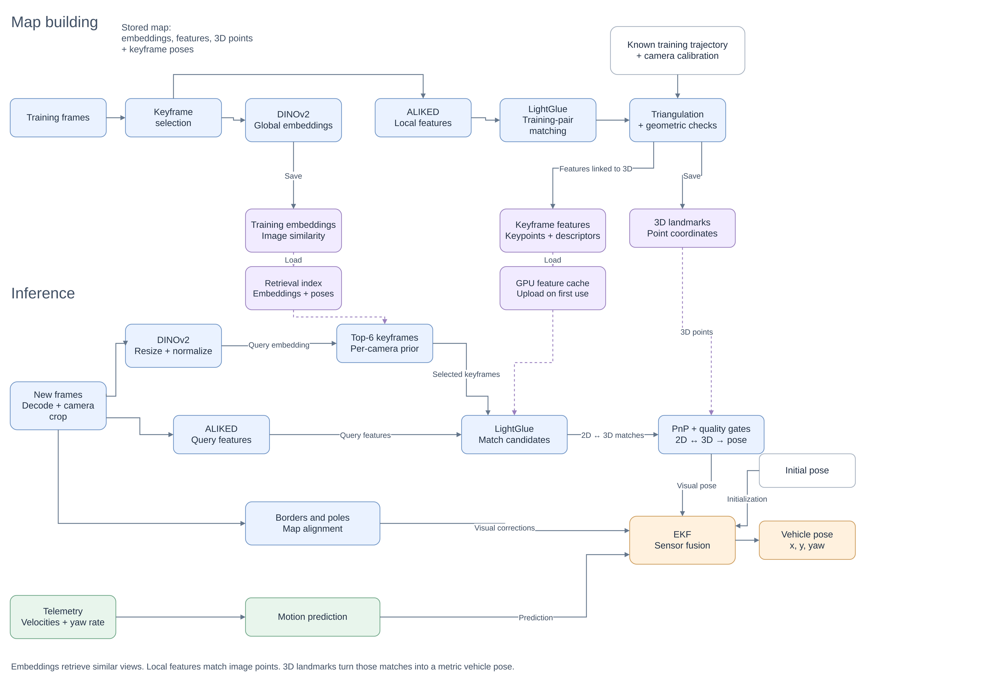

# Camera-based race-car localization on Yas Marina
## Idea

The system estimates a race car's position and heading from seven onboard cameras, calibration, a landmark map, track borders and car-state telemetry. It starts from one supplied pose and produces causal poses at 10 Hz. The released system uses camera landmark matching, border and pole measurements, and a telemetry-based track-coordinate filter; it has no learned sequence layer.



[PDF](scheme.pdf) · [Editable diagram](scheme.drawio) · [Results and reproducibility](docs/RESULTS.md)

## Requirements

- Linux with one CUDA GPU; about 9 GB peak GPU memory.
- About 2 GB RAM, 1 GB for assets, and 7 GB for the Pixi environment.
- Python 3.11.6 and PyTorch 2.3.1 with CUDA 12.1 are pinned by `pixi.lock`.
Environment and dependency versions are managed with [Pixi](https://pixi.prefix.dev/latest/).

## Install

```bash
pixi install --locked
```

If CUDA detection fails on the host, prefix the command with `CONDA_OVERRIDE_CUDA=12.4`.
Runtime inference is offline (`HF_HUB_OFFLINE=1`). `pixi run camloc-run` uses `final-v2`; `pixi run camloc-run-v1` uses `final-v1`.

## Assets

Download `camloc-aramis-assets-final-v1.tar` from the [latest GitHub release](https://github.com/igorkozlovskii/schubki-2026-camloc-aramis/releases/latest) (the same tarball is attached to every release):

```bash
gh release download -R igorkozlovskii/schubki-2026-camloc-aramis -p 'camloc-aramis-assets-final-v1.tar*'
```

```bash
sha256sum camloc-aramis-assets-final-v1.tar
pixi run python tools/verify_assets.py --tar camloc-aramis-assets-final-v1.tar --work /tmp/unpack-check
mkdir -p assets
tar -xf camloc-aramis-assets-final-v1.tar -C assets
mv assets/assets-final-v1 assets/final-v1
pixi run python tools/verify_assets.py --assets assets/final-v1
```

SHA-256: `2f3fffc60b5dcecd211f55912c0779df6fa9c1c4c47c80e16f434199f6d981f9`.
The bundle contains landmark maps, pole and border models, calibration and the ALIKED, LightGlue and DINOv2 checkpoints. See [docs/ASSETS.md](docs/ASSETS.md) for the manifest.

## Licences and pre-trained models

| Component | Use | Licence |
|---|---|---|
| ALIKED | Keypoints and extractor | BSD-3-Clause |
| LightGlue | Local feature matching | Apache-2.0 |
| DINOv2 ViT-S/14 | Global retrieval descriptor | Apache-2.0 |
| ResNet-18 / ImageNet weights | Border-network initialization | BSD-3-Clause / ImageNet terms |
| Track-border network | Border fits | Trained in this project on organizer laps; generated augmentation used Stable Diffusion 1.5 + ControlNet-Canny |
| Landmark, pole and attitude maps | Localization | Derived from organizer recordings; organizer data terms apply |

No external dataset was used for training. Full declarations are in [licenses/license-table.md](licenses/license-table.md) and [licenses/ADDITIONS.md](licenses/ADDITIONS.md).

## Repository layout

```text
pixi.toml, pixi.lock     pinned environment
src/camloc/              runtime library
scripts/                 frozen driver and export CLIs
configs/final/           final-v2 (default) and final-v1 configurations
configs/v2/s122/         E-matcher parameters
configs/models, splits/  model parameters and release splits
schemas/                 data schemas
external/                vendored LightGlue subset
tools/                   asset, source-export and dependency tools
manifests/               asset and source manifests
licenses/                licence declarations
docs/                    release documentation
tests/                   test suite
assets/, dist/, runs/    generated local data; not tracked
```
